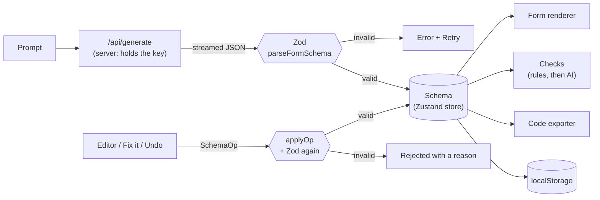

# KYC Studio

**Describe a customer onboarding or KYC flow in plain English. KYC Studio generates a working multi-step form with Indian document validation, checks it for privacy and compliance problems, and exports production-ready React code.**

<!-- TODO: replace with a 30–60s demo GIF: prompt → streaming → checks → Fix it → export -->


**[Live demo](https://YOUR-APP.vercel.app)** · Next.js 16 · React 19 · TypeScript (strict) · Gemini via Vercel AI SDK · Zod · React Hook Form · Zustand · dnd-kit · Vitest · Playwright

> ⚠️ The compliance checks are **hints for developers, not legal or RBI compliance advice.**

### Try these prompts

- *Personal loan KYC: name, DOB, PAN, last 4 of Aadhaar, monthly income, employment type. If self-employed, ask GSTIN. Bank account with IFSC. 3 steps.*
- *Merchant onboarding: business name, business type, GSTIN, owner name, owner PAN, mobile, settlement bank account with IFSC. 3 steps.*
- *Account opening: name, mobile, full 12 digit Aadhaar number, PAN. 2 steps.* (watch it refuse the full Aadhaar)

---

## Why I built this

At M2P and Tyfone I built KYC and onboarding flows by hand: loan origination, account opening, GST verification. Each one took weeks of form logic, validation rules, conditional fields and compliance fixes, and the same mistakes kept coming back: collecting the full Aadhaar number, a missing consent step, a step with so many fields that users quit.

Generic AI form builders (Typeform, Jotform, Tally) make generic forms. KYC Studio is narrow on purpose:

- **Indian field types built in:** PAN, GSTIN (with the real mod-36 checksum), IFSC, Aadhaar (last 4 only), pincode, mobile, bank account.
- **A compliance and privacy check** that flags data you shouldn't collect, missing consent and unmasked sensitive fields, each with a one-click **Fix it**.
- **A drop-off risk score per step**, with fixes like "split this step".
- **Code export** of the flow as a standalone React + React Hook Form + Zod component.

## Features

| | |
|---|---|
| **Generate** | Prompt → Gemini streams a form schema; steps and fields appear live. Invalid AI output never reaches the UI: you get a clear error and **Retry**. A stream cut off halfway is kept and marked *Incomplete*. |
| **Edit** | Three-column studio: outline (drag to reorder, by mouse **or keyboard**), live customer preview, and field settings (type, label, help text, required, masking, options, limits, conditional logic). Undo/redo for every change (⌘Z / ⌘⇧Z). Autosaved. |
| **Check** | Rule-based checks run live as you edit. An AI review adds what rules can't judge (e.g. "is this field needed for the stated purpose?"). Every issue has a severity (as text, not colour alone) and most have **Fix it**. |
| **Preview** | Fill the form as a customer: masking with Show/Hide, Indian validation, conditional fields, and **"What's this?"** plain-language help on every field. |
| **Export** | Copy or download the React component or the schema JSON. |
| **Save** | Flows are saved in the browser and listed on the dashboard with an issue-count badge. |

## Architecture

**The form schema (JSON) is the single source of truth.** The AI writes it, the editor changes it, the renderer draws it, the checks read it, and the exporter turns it into code.



Two ideas hold it together:

1. **Nothing untrusted becomes state without passing Zod.** AI output, localStorage and request bodies are all validated by the same schema. Cross-field rules that JSON Schema can't express (unique ids, `showIf` only pointing *backwards*, options for dropdowns) live in `superRefine`.
2. **Every change is a typed `SchemaOp`** (`updateField`, `moveField`, `splitStep`…). Fix it, the editor, drag-and-drop and undo/redo all go through one function, `applyOp`. It never mutates its input, and it rejects any change that would break the schema (e.g. deleting a field another field's condition depends on).

### Project structure

```
app/
  page.tsx                 dashboard: prompt + saved flows
  studio/[id]/page.tsx     the studio
  api/generate/route.ts    prompt → streamed schema (Gemini)
  api/check/route.ts       AI compliance review
  api/explain/route.ts     "What's this?" for one field
lib/
  schema/zod.ts            the schema: shape for the AI + cross-field rules
  schema/ops.ts            SchemaOp + applyOp (the only way to change a schema)
  validators/india.ts      PAN, GSTIN checksum, IFSC, mobile, pincode…
  checks/rules.ts          rule-based compliance + drop-off checks (no AI)
  checks/aiReview.ts       AI review: safe fix actions only
  export/toReact.ts        schema → React + RHF + Zod source code
  store/useStudioStore.ts  Zustand store with undo/redo
  storage/flows.ts         localStorage, re-validated on read
  api/                     rate limiting + shared route guards
components/
  renderer/                schema → working form (knows nothing about AI)
  studio/                  outline, settings, checks, export, tabs
e2e/                       Playwright tests (AI mocked) + axe accessibility
```

## Design decisions

**Why a schema-driven renderer instead of asking the AI for JSX?** JSON can be validated with Zod; generated JSX can't be trusted or edited. The AI only picks *what* fields exist; *how* they're drawn and validated is our code.

**Validation rules live in code, not in the AI's output.** The AI picks a field's *type* (`pan`), and the type picks the validator. The AI can't write a regex at all, so a hallucination can't produce a wrong or ReDoS-prone pattern. All regexes are anchored and linear-time; a test feeds them 100,000 hostile characters.

**Rules first, AI second, for the checks.** "Full Aadhaar collected" is either true or false, so it's a unit-tested rule: instant, free, deterministic. The AI review only adds judgement calls, and it can only suggest fixes from a fixed list of safe actions (rename, add help text, make optional, remove…). The server drops any suggestion that points to a field that doesn't exist, and `applyOp` validates the fix again when it's clicked.

**The API key never reaches the browser.** The browser talks to our route handlers; only they talk to Gemini. Each route checks, cheapest first: rate limit → key present → body valid (Zod) → then calls the model.

**"What's this?" never sends what the customer typed.** The request schema has no `value` field at all, and a test proves a typed name never appears in the request.

**The exporter can't be tricked into writing code.** Every label, message and option is written with `JSON.stringify`, always inside a JSX expression. (Writing them as plain JSX attributes was a real bug: JSX attribute strings don't support backslash escapes. A test with a hostile label caught it.) The test suite compiles the exported code with strict `tsc` **and** renders it and fills it in like a customer.

**Accessibility.** Real labels, errors linked with `aria-describedby`, live regions, focus management between steps, ARIA tabs, keyboard drag-and-drop with custom screen-reader announcements, and severity shown as text, never colour alone. axe runs in the E2E suite in **light and dark mode**.

## Testing

| | |
|---|---|
| **Unit + component** (Vitest, React Testing Library) | 124 tests · **~86% line coverage** of `lib/` + `components/` (CI fails below 70%) |
| **E2E** (Playwright, real browser, production build) | 10 tests: generate → studio, PAN validation, Fix it + undo, export, keyboard drag-and-drop, WCAG A/AA (axe) in light + dark mode |
| **CI** (GitHub Actions) | lint → type-check → unit tests + coverage → build → E2E, on every push and PR |

The AI is **never called in tests**: unit tests mock `fetch` and stream back a recorded real Gemini response; E2E tests mock the API routes at the network level. Tests are fast, free and deterministic, and CI needs no API key.

### Lighthouse

| | Performance | Accessibility | Best practices | SEO |
|---|---|---|---|---|
| Desktop | 99 | 100 | 100 | 100 |
| Mobile | 81–95* | 100 | 100 | 100 |

\*Measured locally on a 2015 laptop CPU. With Lighthouse's default 4× CPU slowdown it scores 81; calibrated for this machine (2×) it scores 95. <!-- TODO: replace with PageSpeed Insights numbers from the live URL. -->

## Known limitations

These are deliberate trade-offs for a portfolio project:

- **Rate limiting and the "explain" cache are in memory, per server instance.** On Vercel, serverless instances don't share memory, so limits are best effort. The production fix is a shared store such as Upstash Redis.
- **Flows are saved in the browser (localStorage)**, so there are no accounts and no sharing across devices. A real product would add a backend with auth and versioned flows.
- **Drop-off risk is heuristic** (fields per step, documents in step 1…), not based on real funnel data.
- **Masking in the preview prevents shoulder-surfing; it isn't encryption.**

## Run it locally

Requires Node 22+.

```bash
git clone <this repo> && cd kyc-studio
npm install
cp .env.example .env.local      # then paste a free key from https://aistudio.google.com/apikey
npm run dev                     # http://localhost:3000
```

| Command | What it does |
|---|---|
| `npm test` | Unit and component tests |
| `npm run coverage` | Tests + coverage report (`coverage/index.html`) |
| `npm run test:e2e` | Builds the app and runs Playwright (uses your installed Chrome locally) |
| `npm run lint` · `npm run typecheck` | ESLint · TypeScript |

## What I'd add with more time

A backend with auth and versioned flows, team sharing and comments, real analytics to replace the drop-off heuristics, Hindi/regional-language labels, more Indian document types (passport, voter ID, CKYC number), and Upstash-backed rate limiting.
